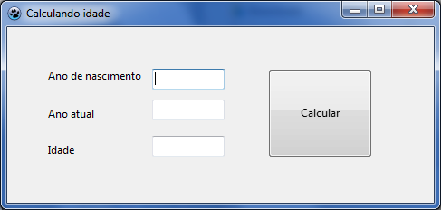

# Exemplo 03 — Diferença entre anos

O programa calcula a diferença entre o ano atual informado e o ano de
nascimento. Abra [exemplo03.lpi](exemplo03.lpi) no Lazarus e execute com **F9**.

## Como usar

1. Informe o ano de nascimento e o ano atual como números inteiros.
2. Clique no botão de calcular.
3. Leia a diferença em anos no campo de resultado.

Os anos devem estar entre 1 e 9999, e o ano atual não pode ser anterior ao ano
de nascimento. Como o cálculo usa apenas os anos, não considera se a pessoa já
fez aniversário neste ano.

## O que estudar

Em [exemplo3.pas](exemplo3.pas), procure a rotina `BitBtn1Click`. Ela lê
números inteiros, valida uma condição composta e subtrai os anos. Se `nasc` é
o ano de nascimento e `atual` é o ano atual:

```text
diferença = atual - nasc
```

## Para praticar

- Use o mesmo ano nos dois campos. Qual deve ser o resultado?
- Teste um ano atual menor que o ano de nascimento.
- O que seria necessário para calcular a idade exata, considerando mês e dia?


