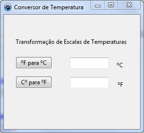

# Exercício 01 — Conversão de temperaturas

Abra [exemplo04.lpi](exemplo04.lpi) no Lazarus para converter entre Celsius e
Fahrenheit. Informe um número e clique no botão da conversão desejada.
O separador decimal pode ser ponto ou vírgula.

## O que observar

Este exemplo pratica a sequência **entrada, processamento e saída**:

1. A rotina do botão lê o valor digitado.
2. A fórmula converte a temperatura: `C = 5/9 × (F - 32)` ou
   `F = 1,8 × C + 32`.
3. O resultado aparece no outro campo.

No Lazarus, abra o arquivo `.pas` correspondente e procure por
`Button1Click` e `Button2Click`. Eles mostram como os eventos da interface
chamam o código Pascal. Teste, por exemplo, `32 °F` e `0 °C`, que correspondem
ao mesmo ponto de congelamento da água.

## Desafio

Acrescente uma validação para aceitar apenas temperaturas acima do zero absoluto:
`-273,15 °C` ou `-459,67 °F`. Aplique o limite adequado à escala que foi digitada.
