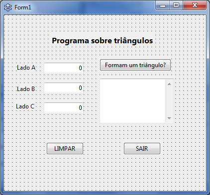

# Exercício 02 — Classificação de triângulos

Informe os três lados de uma figura para verificar se formam um triângulo e,
em caso afirmativo, classificar o triângulo. Abra
[exemplo05.lpi](exemplo05.lpi) no Lazarus e execute com **F9**.

## Como usar

1. Digite os comprimentos dos lados A, B e C. Todos devem ser positivos.
2. Clique em **Triângulo** para ver a mensagem de resultado.
3. Use **Limpar** para recomeçar ou **Sair** para fechar.

Para formar um triângulo, a soma de quaisquer dois lados deve ser maior que o
terceiro. Se formar um triângulo, o programa o classifica como:

- **Equilátero:** três lados iguais.
- **Isósceles:** dois lados iguais.
- **Escaleno:** três lados diferentes.

## O que estudar

Em [exercicio02.pas](exercicio02.pas), procure `BtrianguloClick`. Observe a
validação dos lados, a seleção do maior lado e as condições `if` encadeadas.

## Para praticar

Teste os lados `3, 3, 3`, `3, 3, 4`, `3, 4, 5` e `1, 2, 3`. Explique por que
o último conjunto não forma um triângulo. Depois teste zero e valores negativos.

