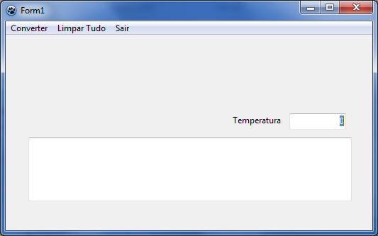

# Exercício 04 — Conversão de temperaturas com histórico

Converta temperaturas entre Fahrenheit e Celsius usando o menu do formulário.
Abra [exercicio04.lpi](exercicio04.lpi) no Lazarus e execute com **F9**.

## Como usar

1. Digite a temperatura no campo.
2. No menu, escolha a conversão desejada: Celsius para Fahrenheit ou Fahrenheit
   para Celsius.
3. O resultado é acrescentado ao histórico. Escolha **Limpar** para apagar o
   histórico ou **Sair** para fechar.

As fórmulas são `F = 1,8 × C + 32` e `C = 5/9 × (F - 32)`. É possível converter
temperaturas negativas.

## O que estudar

Em [exercicio4.pas](exercicio4.pas), observe as rotinas `CparaFClick`,
`FparaCClick` e `LimparClick`. O menu também dispara eventos, assim como os
botões nos outros projetos.

## Para praticar

- Converta `0 °C` para Fahrenheit e `32 °F` para Celsius.
- Faça duas conversões antes de limpar. O que acontece com o histórico?
- Explique por que as duas fórmulas são diferentes.

