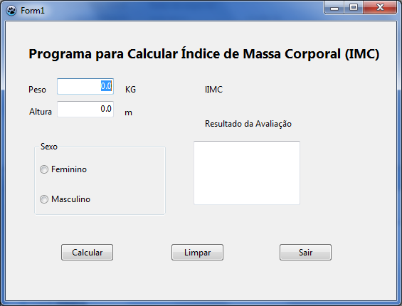

# Exercício 05 — Cálculo do IMC

Este projeto calcula o índice de massa corporal (IMC) a partir do peso e da
altura e apresenta uma classificação didática. Abra
[exemplo06.lpi](exemplo06.lpi) no Lazarus e execute com **F9**.

## Como usar

1. Informe o peso em quilogramas e a altura em metros, ambos maiores que zero.
2. Selecione uma opção no grupo de sexo.
3. Clique em **Calcular** para exibir o IMC e a classificação. **Limpar** apaga
   os campos e a seleção.

A fórmula é:

```text
IMC = peso ÷ altura²
```

## O que estudar

Em [exercicio05.pas](exercicio05.pas), procure `btCalcularClick`. A rotina
valida as entradas, calcula o IMC e usa condições encadeadas para escolher uma
faixa. As faixas foram mantidas do material de aula para fins didáticos; o
resultado não é orientação médica.

## Para praticar

- Use peso `70` kg e altura `1,75` m. Confira o resultado aproximado.
- Compare valores imediatamente abaixo e acima de um limite de classificação.
- Tente calcular sem selecionar uma opção ou usando altura zero.


