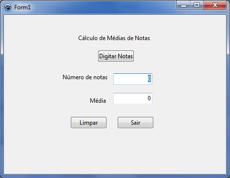

# Exercício 06 — Média de notas

Digite notas em sequência; o programa calcula a quantidade informada e a média.
Abra [exercicio06.lpi](exercicio06.lpi) no Lazarus e execute com **F9**.

## Como usar

1. Clique em **Digitar** e informe uma nota por vez.
2. Digite `-1` ou clique em **Cancelar** para encerrar.
3. Veja a quantidade de notas e a média nos campos de resultado.
4. Use **Limpar** para zerar os resultados.

Notas negativas diferentes de `-1` são rejeitadas. Se encerrar sem digitar uma
nota, a quantidade e a média ficam em zero.

## O que estudar

Em [exercicio6.pas](exercicio6.pas), procure `BdigitarClick`. A repetição
`while` mantém a leitura até a sentinela. `quantidade` conta as notas, e `media`
é atualizada a cada entrada.

## Para praticar

- Informe `6`, `8` e `10`; confira a média e a quantidade.
- Termine imediatamente com `-1`. O que aparece?
- Tente informar uma nota inválida e depois continue digitando.

